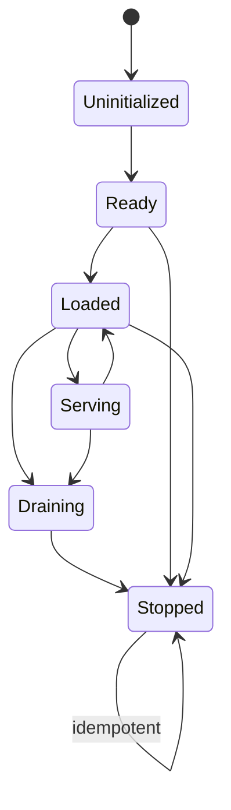
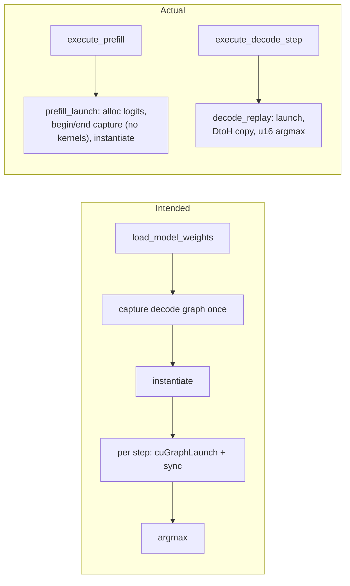

# System Architecture

Last updated: 2026-10-28. Basis: source read directly (`helios/`, `ignition/`, `specification/`, CLAUDE.md). `repomix-output.xml` not used for Helios runtime files.

**Snapshot note:** code was changing while this was written (scheduler `run()` gained a `CancellationToken`). `cargo check/build/test --workspace` pass on the stub backend as of the last check; re-verify runtime details before relying on them.

Tags: **[impl]** implemented, read in code. **[partial]** exists, path incomplete. **[pending]** decided in CLAUDE.md, absent from code. **[gap]** code contradicts intent (see Known gaps).

---

## 1. Two-stage architecture

HF checkpoint -> Ignition (Python, compile) -> `.hyperion` + `.manifest.json` -> Helios (Rust, `helios-cli`) -> HTTP API.

- **Ignition** [partial]: writes `<out>.manifest.json`. Weight blob write and ed25519 signing are TODO (`cli.py:37`). Architecture plugins (`llama`, `qwen`, `deepseek`) emit `layers=[]`.
- **Helios** [partial]: boots from the sidecar JSON only. No `.hyperion` codec (`helios-pkg` does not exist), no signature check, no weight load.
- Runtime has no Python.

Crate deps: `helios-core` -> `helios-hal` (trait only) + spec; `helios-cli` -> core, hal, spec. Rule 1 (core knows no GPU) holds in code.

## 2. Runtime boot flow

```mermaid
sequenceDiagram
    participant CLI as helios-cli
    participant HAL as hal::create_backend
    participant SM as StateMachine
    participant SCH as Scheduler task
    CLI->>CLI: load_manifest(sidecar JSON), serde tag check
    CLI->>HAL: create_backend(target_arch)
    HAL->>HAL: candidates sm120 -> sm90 -> stub (compiled-in)
    HAL->>HAL: initialize_device(), Triage::evaluate
    CLI->>SM: mark_ready()  Uninitialized -> Ready
    CLI->>SCH: spawn run(); supervisor awaits JoinHandle
    CLI->>CLI: tokenizer: empty asset_path -> None; else must exist
    CLI->>CLI: axum serve 127.0.0.1:port (--bind)
```

Shutdown: ctrl-c/SIGTERM -> `drain()` -> serve returns -> abort supervisor -> `backend.shutdown()` -> `shutdown()`.

Not reached at boot: `load_model_weights`, `allocate_kv_cache`, prefill, decode. Engine stays `Ready`. [partial]
## 3. HAL: `ComputeBackend` contract

Trait in `helios-hal/src/traits.rs`. `&self` methods; `Send + Sync`; core holds `Arc<DynBackend>`.

| Method | stub | blackwell_sm120 | hopper_sm90 |
|---|---|---|---|
| `initialize_device` | `sm_0`, zero VRAM | real probe: cap, VRAM, primary ctx, stream | `sm_90` hard-coded, no FFI |
| `load_model_weights` | Ok no-op | Err (pending codec) | Err |
| `allocate_kv_cache` | zero pointers | `cuMemAlloc` per block; dims hard-coded | Err |
| `execute_prefill` | fake tensor | alloc logits, capture (zero nodes), instantiate | Err |
| `execute_decode_step` | Ok(0) | graph replay + sync + argmax | Err |
| `shutdown` | default Ok | destroys stream, releases ctx | default Ok |

- Trait doc says new methods must be default-implemented. [gap] All five required methods lack defaults.
- **Triage** [done]: exact match only (`triage.rs`); also checks that the backend's own arch equals the probed device and that `tensor_format` is in the arch's table. Stub reports `sm_0`, so it serves only `sm_0` packages (typecheck target).

**Backend selection** [gap]: order sm120 -> sm90 -> stub over compiled-in candidates. The loop returns the first candidate and never checks that the probed device matches its kind. A `multi` build on H100 would pick sm120 (its probe succeeds on any CUDA device and reports `sm_90`).

## 4. Engine state machine

`helios-core/src/state.rs`. `AtomicU8` + CAS loop; `current()` is `load(Acquire)`, so API status reads are lock-free.



- Any target from `Stopped` other than `Stopped` returns `Terminal`. Illegal pairs return `IllegalTransition`. The match table makes new variants hit exhaustiveness.
- Call sites [impl]: `mark_ready` (CLI), `drain` and `shutdown` (CLI, supervisor).
- [gap] No call sites for `mark_loaded`, `begin_serving`, `end_serving`. `Loaded` and `Serving` are never entered.
- [gap] `Ready -> Draining` is not in the table, so `drain()` fails on the no-weights path. CLI then logs "already past Draining", which is misleading.

## 5. API layer

`helios-core/src/api.rs`. Axum router: `GET /health` and `POST /v1/chat/completions` (nest applied inside `router()`).

- [done] `/v1` nest and `/health` landed in phase 01.
- Request: `model`, `messages[{role, content}]`, `max_tokens` (default 1024), `temperature`, `top_p`. Unknown fields ignored. Non-streaming only.

Handler flow: status gate -> tokenizer (501 if none) -> encode (422 on error or empty) -> ingress send, 500 ms timeout, bounded queue cap 32 -> first event, 5 s timeout -> fold `Tokens` until `Done`/`Error` -> decode -> 200.

| Condition | Status |
|---|---|
| Engine status Uninitialized / Draining / Stopped | 503 |
| No tokenizer loaded | 501 |
| Tokenize error or zero tokens | 422 |
| No ingress channel, queue closed, or send timeout | 503 |
| Stream closed before first event | 503 |
| No first event within 5 s | 504 |
| Scheduler `Error` or decode failure | 500 |
| Success | 200 |

- [gap] CLAUDE.md reserves 503 for Uninitialized/Stopped; code also uses it for Draining, overload, and closed scheduler. 429 appears in comments only.
- [gap] Current scheduler `run()` discards each request, dropping `response_tx`. Requests on a booted server with a tokenizer end as 503. The 504 path is effectively unreachable until the loop does real work.
- [gap] Response body has `id`, `model`, `choices[...]` only. No `object`, `created`, `usage`; strict OpenAI clients may reject it.

## 6. Tokenizer path

`helios-core/src/tokenizer.rs`; wiring in `main.rs`.

1. `tokenizer.asset_path` is package-relative; absolute and `..` rejected.
2. Empty path -> boot without tokenizer; every request gets 501. Missing file -> boot fails.
3. `PromptTokenizer` loads lazily (`OnceCell`). Truncation = manifest `model.max_seq_len`.
4. Prompt is a placeholder `role:content` join, not a chat template. Real template waits on the codec.
5. Encode uses special tokens; decode skips them.
6. Dependency: `tokenizers` 0.22 with `onig` (0.22 requires a regex backend).
7. [gap] `tests/encode_path_smoke.rs` uses a cwd-relative fixture path; CLAUDE.md requires `CARGO_MANIFEST_DIR`.

## 7. RadixCache (intent vs code)

`helios-core/src/cache.rs`, 60 lines.

- Intent: 256-token chunks, prefix reuse by hash, HAL-allocated blocks, refcounts, per-tier eviction; LMCache-style sidecar later.
- [partial] Implemented: `HashMap<ChunkHash(u64), {block_id, refcount}>`, `lookup`, `insert`. No release, no eviction (TODO). No caller outside `cache.rs`.
- [gap] Key is the chunk's own content hash. KV depends on preceding context, so identical chunks after different prefixes alias. Key must chain the parent hash.

## 8. Manifest and spec versioning

`specification/src/lib.rs`, `v1/mod.rs`. Rust structs are the schema source.

- `enum Manifest { V1(v1::Manifest) }`, `#[serde(tag = "manifest_version")]` (wire tag `"V1"`), `LATEST = 1`.
- v1 fields: `model_id`, `target_arch`, `tensor_format` (`bf16|fp8|fp4`; the format actually written, `bf16` today), `model{num_layers, attention (`mha|gqa`), num_attention_heads, num_kv_heads, head_dim, vocab_size, max_seq_len}`, `tokenizer{family, asset_path}`, `layers[{index, name, byte_offset, byte_length, tensor{dtype, shape}}]`, `hardware_recipe` (k/v), `signature?` (bytes). All structs use `deny_unknown_fields`.
- [done] Tag mismatch fixed (P0b): both sides use `"V1"`; JSON Schema and shared fixtures guard it.
- [partial] `ModelConfig` is in v1; sm120 still hard-codes dims until it reads the manifest.
- [done] JSON Schema generated from the Rust structs (`schemars`, feature `schema`), committed at `specification/schema/manifest.v1.json`; Ignition validates with `jsonschema`; fixtures in `specification/fixtures/v1/` are parsed by both sides.
- [pending] Signature: field exists, nothing verifies it; Python always writes `null`.

## 9. SM120 CUDA Graph path

`helios-hal/src/backends/blackwell_sm120/`. Real FFI via `cuda-driver-sys` under `feature = "sm120"`; no mocks. Linking needs CUDA; this host can only typecheck.



- Probe: `cuInit`, device 0, cap -> `sm_{major}{minor}`, VRAM, primary ctx, non-blocking stream. Intended load-time capture cannot run: `load_model_weights` refuses until the codec exists.
- [gap] Graph is captured in `prefill_launch`, which nothing calls from the CLI. Re-capture leaks old graph, exec and logits buffer. `capture_empty_graph` sets `captured` with no graph.
- [gap] Other issues: `execute_prefill` reports `byte_size` for `len` rows but allocates one; argmax on raw bf16 bits; `static mut LOGITS_PTR` assumes one backend. Zero-node capture on the driver is unverified.

## 10. Build matrix

- `cargo build --workspace` (stub): builds and tests pass (1 warning in `api.rs`).
- `helios-hal --features sm120` and `--features sm90`: type-check on this host; link + run verified on an H100 pod (CUDA toolkit needed to link).
- `helios-cli --features sm90/sm120`: fails, helios-cli declares no features (Taskfile `build:sm90`/`build:sm120` broken).

## 11. Decided vs implemented (CLAUDE.md)

| Decision | Status |
|---|---|
| State machine, lock-free reads, CUDA FFI (`sm120`-gated), HF tokenizers | [impl] (FFI typecheck only) |
| 501 without tokenizer | [impl] |
| RadixCache index, 256-token chunks | [partial] |
| 503 reserved for Uninitialized/Stopped | [gap] used more broadly |
| Exact `target_arch` triage | [done] |
| Backend order sm120 -> sm90 -> stub | [partial], no device-kind check |
| `helios-pkg`, `/v1` nesting, backend use of `ModelConfig` | [pending] / [gap] |

## Known gaps

Re-verified in current source.

1. Factory returns first compiled candidate without comparing probed device to kind (`backend_factory.rs:65-70`).
2. sm90 hard-codes `sm_90` (`hopper_sm90/backend.rs:27`); doc mentions a `kernels.rs` that does not exist.
3. ~~Manifest tag mismatch~~ resolved in P0b.
4. `/v1` not nested.
5. `Loaded`/`Serving` unused; concurrency not modeled. (Earlier candidate "Loaded marked without weights" is false; the reverse holds.)
6. `Ready -> Draining` illegal; shutdown warns misleadingly.
7. RadixCache key does not chain parent hash; no release/eviction.
8. Hard-coded KV/vocab dims in sm120 (`backend.rs:73-75`, `kernels.rs:28`).
9. sm120 prefill `byte_size` mismatch; leaks on re-capture; argmax on bf16 bits (`kernels.rs`, `graph.rs`).
10. Response body lacks `object`, `created`, `usage`; 503 overuse vs CLAUDE.md, 429 never emitted.
11. Tokenizer test fixture path cwd-relative; helios-cli has no feature flags (Taskfile sm90/sm120 fail).
12. ~~Triage Downgrade contradicts CLAUDE.md~~ resolved in phase 01.

## Unresolved questions

- ~~Which manifest tag form wins~~ resolved: `"V1"`.
- ~~Downgrade triage or exact match~~ resolved: exact match.
- Apply `/v1` via `nest` in CLI or in `api::router()`?
- 503 vs 429 split: CLAUDE.md or current code? Zero-node graph capture valid on target driver? Needs CUDA host.
- Should `main.rs` cancel the scheduler token on shutdown instead of aborting the supervisor?
